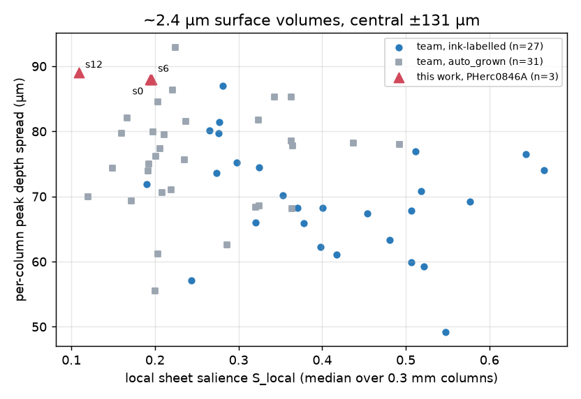

# PHerc0846A at 2.4 µm: an inconclusive First Letters search, a lightweight renderer and a sheet-profile check

**In one paragraph.** We grew three automatic patches on PHerc0846A's 2.403 µm scan (≈32 cm² with CT
data), rendered them with ±155 µm of depth and ran the canonical 2 µm ink model in three depth windows and
both layer orders: **no letters, no rows, no stroke-like shapes** in any of the 18 maps. The same chain finds
the labelled letters on PHerc0139 w043 (AUC 0.87; 0.89 on the team's own render). But the patches
themselves sit in the low tail of team surfaces on a simple sheet-profile check, so this is **weak
evidence**: it says the model sees no text on these automatic meshes, not that the band has no ink.
Along the way: a lightweight tifxyz renderer (validated slice by slice against a team surface volume) that
rendered this scan where `vc_render_tifxyz` crashed, and a label-free sheet-profile check for surfaces.

All claims as of 4 Oct 2026.

## Why PHerc0846A

- [Bullo27/first-letters-survey](https://github.com/Bullo27/first-letters-survey) ran the released
  `ink_9um` models on all 21 eligible scrolls at ~9 µm: speckle only.
- [ShribyrLabs](https://github.com/ShribyrLabs/vesuvius-reports) measured that downsampling 2.4 µm layers
  to 9 µm drops the canonical model's letter-scale score from 0.95 to 0.11.
- In the open-data bucket only two eligible scrolls have a 2.4 µm scan: PHerc1203 (reported negative by
  [TAUIL-Abd-Elilah](https://github.com/TAUIL-Abd-Elilah/cross-scan-ink-transfer)) and **PHerc0846A**,
  for which we found no public report. Its scan is a ~36 mm band (15137 slices) at full width.

## Pipeline

| Step | Tool | Notes |
| --- | --- | --- |
| Seeds | `grow_patch.py seeds` | scan level-5 mask + team m7-L2 surface prediction (same 32-voxel grid); 18 seeds at 0.3/0.5/0.7 band height |
| Grow | `vc_grow_seg_from_seed`, VC3D image `ghcr.io/scrollprize/villa/volume-cartographer@sha256:bad516f6…c8083c4` | GrowPatch parameters as in Bullo27, 100 generations, level-2 (9.612 µm) coordinates |
| Render | `render_tifxyz_light.py` | level 0 (2.403 µm), `--seg-level-factor 4`, 129 slices (±64 voxels) |
| Ink | `canonical2um_infer.py` | `scrollprize/ink_canonical_2um`, villa `f637f3b3` optimized_inference unchanged, 62-slice windows starting at 1/33/66, both orders, 256-px tiles, stride 128 |
| Review | `make_sheets.py` | blind review of prediction-only sheets first, numbers afterwards |
| Surface check | `qc_sheet_profile.py` | see below |

## Result on PHerc0846A

| Patch (seed, band height) | CT-covered area | p ≥ 0.5, default order (windows 1/33/66) | reverse order |
| --- | ---: | --- | --- |
| s12 (upper) | 14.3 cm² | 2.8 / 3.0 / 2.6 % | 3.3 / 3.3 / 4.0 % |
| s6 (middle) | 9.3 cm² | 6.9 / 5.8 / 5.8 % | 9.3 / 9.8 / 8.2 % |
| s0 (lower) | 10.0 cm² | 8.0 / 8.2 / 9.3 % | 9.3 / 9.8 / 7.9 % |

Fractions are over pixels whose rendered CT is non-zero. s0 and s6 overlap (≈18 % of their mesh nodes lie
within 10 voxels of the other patch), so the unique area is ≈32 cm² (a few percent of the 2.4 µm band).
All maps show rounded blobs of 0.3–0.5 mm, radial streaks following mesh geometry and fibre striping;
the reverse order is at least as noisy as the default order.


Rows: depth windows 1/33/66; columns: default/reverse order. Also [s6](results/figures/s6-sheet.jpg),
[s0](results/figures/s0-sheet.jpg), and the [middle CT slice of s12](results/figures/s12-ct-middle-slice.jpg).
Per-map numbers: `results/s*-stats.json`; overview: [results/summary.json](results/summary.json).

## Positive control: PHerc0139 w043 (`validate_w043.py`)

w043 has letters labelled in the [ink_9um dataset](https://huggingface.co/buckets/scrollprize/datasets/tree/ink_9um)
(`pherc0139-w043`, annotated on the 2.4 µm render pooled 4×, so a level-0 window maps exactly onto it).
On a 2048×4096 window around the labelled κ and ρ (133 672 supervised pixels on the 9.6 µm label grid,
61 960 of them ink), with stride 128 throughout:

| Render | AUC, right layer order | AUC, wrong order |
| --- | ---: | ---: |
| team surface volume | 0.888 | 0.446 |
| ours, from the team mesh `…-on-20260102150214-2.399um.tifxyz` | 0.872 | 0.439 |

Our render vs the team's, same window: CT sampled at 400 mesh nodes vs the team's middle slice r = 0.93;
every one of our 65 slices k matches team slice 86 − k with r = 0.993–0.994 (same geometry and spacing,
**opposite layer order**). The text row and the tail of ρ appear only in the right order:


The model card does not document the training data, and PHerc0139 surfaces may well be in it, so this
controls the chain (render geometry, layer order, model I/O); it is not evidence of transfer.

## Surface quality: `qc_sheet_profile.py`

A mesh that follows a sheet shows a CT-intensity peak along the normal (dense papyrus between gaps or
neighbouring windings). For a surface volume we sample 40 random 0.3 mm columns and report the median
per-column peak salience **S_local** and the **spread of the peak depth** between columns. Results for the
~2.4 µm surface volumes in the open-data bucket (central ±131 µm), with our patches cropped to the same depth:



| Surfaces | n | S_local median (min) | peak-depth spread median (90th pct) |
| --- | ---: | --- | --- |
| team, with ink labels | 27 | 0.40 (0.19) | 69 µm (80) |
| team, `auto_grown` | 31 | 0.22 (0.12) | 77 µm (85) |
| **ours, PHerc0846A** | 3 | 0.11 / 0.20 / 0.19 | 88–89 µm |

Our patches are among the weakest surfaces on both measures. The check is useful but not a verdict: S_local
also tracks the scan's sheet contrast (PHercParis4 0.24–0.38 vs PHerc0139/1667 0.40–0.66), and we have no
team surface on PHerc0846A to compare against. A controlled test (`tilt_experiment.py`, w043 mesh tilted by
T across the 1 cm window) shows why the per-column version is needed:

| Tilt T | 0 | 50 µm | 100 µm | 200 µm | 400 µm |
| --- | ---: | ---: | ---: | ---: | ---: |
| patch-average S | 0.42 | 0.28 | 0.08 | 0.06 | 0.04 |
| S_local | 0.53 | 0.52 | 1.07 | 0.90 | 0.37 |
| model AUC | 0.87 | 0.84 | 0.87 | 0.84 | 0.68 |

A slow depth drift flattens the patch-average profile while the model still reads the letters; S_local only
drops when the sheet leaves the rendered window (T = 400 µm).

## The lightweight renderer

`vc_render_tifxyz` from the `edge` image above has no `--flip-normals`; on a 0.5 cm² test patch of this scan
it crashed with `corrupted size vs. prev_size` and hung after pulling ~31 GB. `render_tifxyz_light.py`
finished the same patch with 4.7 GB of downloads (11 min serially; 41 s from cache with 6 worker processes,
bit-identical output). It

- upsamples the tifxyz grid to level-0 pixels (node i at pixel i/scale, the VC convention);
- takes normals from the grid and orients the whole patch with **one** sign (majority vote away from the
  image centre);
- fetches only the raw 128³ chunks the ±N-slice shell touches (disk cache), renders 256-px tiles in
  parallel processes, and writes a surface-volume zarr in the published layout.

Its slice order is the reverse of `vc_render_tifxyz` on w043; run inference in both orders.
Linux / WSL only (it uses the `fork` start method); needs zarr ≥ 3.

**Bug found by review and fixed before release.** An earlier version chose the normal sign per mesh node.
On our PHerc0846A patches that flipped the depth order on 50 % (s12), 18 % (s6) and 10 % (s0) of the nodes.
All three patches were re-rendered and all 18 maps re-run with the fixed code; the numbers above are from
the fixed run. (w043 was unaffected: r ≥ 0.99 for every slice either way.)

## Costs

RTX 5070 Ti 16 GB, Ryzen 7 7800X3D, 30 GB RAM (WSL2), home connection ~26 MB/s.

- Grow: 22–79 min per 100-generation patch (s12 22, s0 37, s6 79 min; the three grows overlapped and shared
  the CPU). **Keep the tracer's work directory on a native Linux filesystem**: with normal grids on a Windows
  drive bind-mounted into Docker Desktop we measured 50 generations in 3 h (<1 core busy, 65 % grid-cache
  hits); on ext4, 15 generations took 22 s.
- Render: 25–45 min per patch at 129 slices; 27–93 GB downloaded per patch (≈190 GB in total). s0 cut more
  chunks than its area suggests; s6 reused chunks already cached for the overlapping s0; s12's figure
  includes one failed first attempt.
- Model: 10–15 min per window and order; 18 maps ≈ 4 h.
- Altogether about 8–9 h of machine time for three patches.

## Limitations and deviations

- Automatic meshes only, no human check of the inked layer; one ink model; ≈32 cm².
- Patches are weak on the sheet-profile check (above), so a negative here does not mean the band has no ink.
- Planned but not run: the shuffled-block and off-papyrus controls (there were no candidates to test them on)
  and a pooled-9.6 µm `ink_9um` comparison. Rendering moved from `vc_render_tifxyz` with 65 slices to our
  renderer with 129 slices after the crash described above.
- Probability maps (~40 MB each) are not in the repository; meshes are (`results/meshes/`), so every map can
  be regenerated with `run_patch.sh`.

## Reproduce

```bash
pip install -r requirements.txt     # plus torch with CUDA and villa optimized_inference requirements
export WORK=~/fl-work OUT=/big/disk/fl-out \
       CKPT=/path/r152_3ddec_v2_l5_epoch13.ckpt \
       VILLA_INK_OPT=/path/villa/ink-detection/optimized_inference
bash scripts/run_patch.sh 12        # also 6 and 0
# to reuse our meshes instead of growing: mkdir -p $WORK/patches/s12-ours-g100 &&
#   cp -r results/meshes/s12 $WORK/patches/s12-ours-g100/auto_grown_ours   (same for s6, s0)
python scripts/validate_w043.py --work ~/w043-check --labels /path/pherc0139-w043 --checkpoint "$CKPT"
python scripts/tilt_experiment.py --work ~/w043-check --labels /path/pherc0139-w043 --checkpoint "$CKPT"
python scripts/qc_sheet_profile.py --from-metadata labelled --resolution 2.4 --out qc.jsonl
```

## Credits and licences

- Code in this repository: MIT (`LICENSE`). Seed placement, grid prefetching and GrowPatch parameters in
  `grow_patch.py` are adapted from [Bullo27/first-letters-survey](https://github.com/Bullo27/first-letters-survey),
  MIT, notice in `LICENSE-THIRD-PARTY`.
- Tools: [ScrollPrize/villa](https://github.com/ScrollPrize/villa) (VC3D, optimized_inference).
  Model: [scrollprize/ink_canonical_2um](https://huggingface.co/scrollprize/ink_canonical_2um) (MIT per its model card).
- CT data, surface predictions, meshes and labels: Vesuvius Challenge open data, CC BY-NC 4.0. Figures and
  meshes in `results/` derive from that data and carry the same licence.
