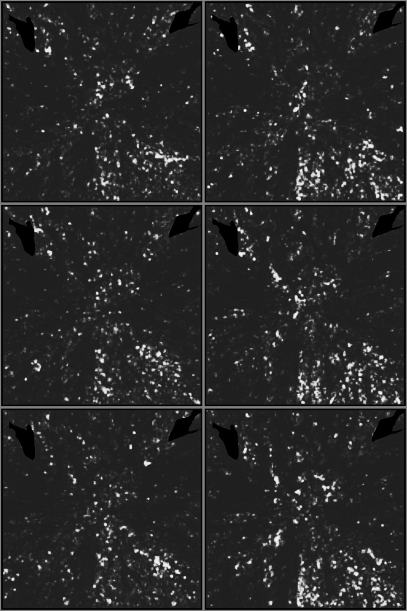
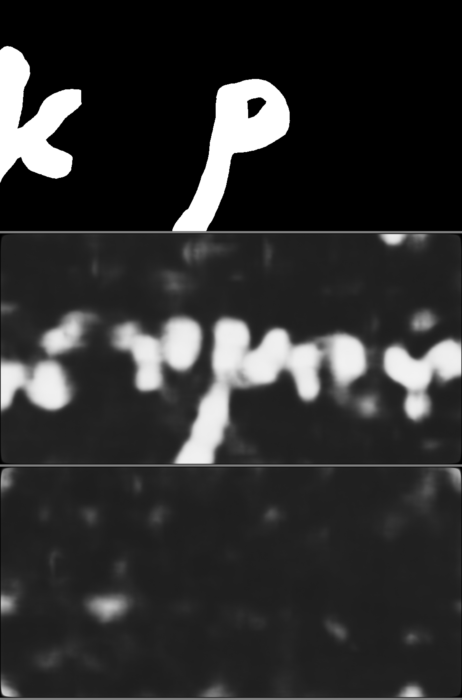
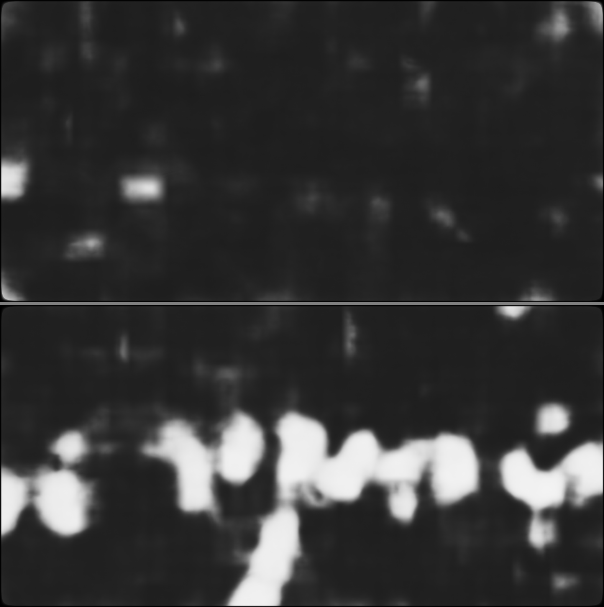

# PHerc0846A at 2.4 µm: a First Letters search on the high-resolution band

**Result: no ink candidates** on ~32 cm² of PHerc0846A's 2.403 µm scan, read with the canonical
2 µm ink model in three depth windows and both layer orders. The same chain finds the labelled
letters on PHerc0139 w043 (AUC 0.87–0.89), so the negative is about this scroll/area/model, not a
broken pipeline. Along the way: a lightweight tifxyz renderer that renders 2.4 µm patches with
~6–8× less traffic than `vc_render_tifxyz` (which crashed on this scan), validated slice by slice
against a team surface volume.

## Why this scroll

- [Bullo27/first-letters-survey](https://github.com/Bullo27/first-letters-survey) ran the released
  `ink_9um` models on all 21 eligible scrolls at ~9 µm: speckle only.
- [ShribyrLabs](https://github.com/ShribyrLabs/vesuvius-reports) measured that downsampling 2.4 µm
  layers to 9 µm drops the canonical model's letter-scale score from 0.95 to 0.11.
- Only two eligible scrolls have a 2.4 µm scan: PHerc1203 (already reported negative by
  [TAUIL-Abd-Elilah](https://github.com/TAUIL-Abd-Elilah/cross-scan-ink-transfer)) and
  **PHerc0846A**, for which we found no public report. Its 2.403 µm scan is a ~36 mm band
  (15137 slices) at full width.

## What we did

| Step | Tool | Notes |
| --- | --- | --- |
| Seeds | `grow_patch.py seeds` | scan level-5 mask + team m7-L2 surface prediction (same 32-voxel grid), 18 seeds at 0.3/0.5/0.7 band height |
| Grow | `vc_grow_seg_from_seed` (VC3D `edge` Docker image) | GrowPatch parameters as in Bullo27, 100 generations, in level-2 (9.612 µm) coordinates |
| Render | `render_tifxyz_light.py` | level 0 (2.403 µm), `--seg-level-factor 4`, 129 slices (±64 voxels = ±155 µm) |
| Ink | `canonical2um_infer.py` | `scrollprize/ink_canonical_2um`, 62-slice windows starting at 1/33/66, both layer orders, 256-px tiles, stride 128 |
| Review | `make_sheets.py` | blind review of prediction-only sheets before looking at any numbers |

Three patches (seeds 12, 6, 0 — upper, middle, lower band):

| Patch | CT-covered area | Download | p ≥ 0.5, default order (windows 1/33/66) | reverse order |
| --- | ---: | ---: | --- | --- |
| s12 | 14.3 cm² | ~71 GB | 2.5 / 2.6 / 2.4 % | 3.6 / 3.6 / 4.0 % |
| s6 | 9.3 cm² | 27 GB | 6.9 / 6.3 / 6.4 % | 9.0 / 9.6 / 8.0 % |
| s0 | 10.0 cm² | 93 GB | 8.2 / 8.2 / 9.1 % | 9.3 / 9.5 / 7.8 % |

s0 and s6 overlap (~18 % of their mesh nodes lie within 10 voxels of the other patch), so the
unique CT-covered area is ≈32 cm². Mesh `area_vx2` overstates it because patches run past the ends
of the 2.4 µm band.

**All 18 maps:** rounded blobs of 0.3–0.5 mm, radial streaks that follow mesh geometry, vertical
fibre striping — no rows, no strokes, no letter shapes in any window or order, and the reverse
order is at least as noisy as the default.



Sheets for [s6](results/figures/s6-sheet.jpg) and [s0](results/figures/s0-sheet.jpg); rows are depth
windows 1/33/66, columns default/reverse order. Numbers: [results/summary.json](results/summary.json).

## Positive control and renderer validation (PHerc0139 w043)

w043 has letters labelled in the [ink_9um dataset](https://huggingface.co/buckets/scrollprize/datasets/tree/ink_9um)
(`pherc0139-w043`, annotated on the 2.4 µm render pooled 4×, so a level-0 window maps exactly).
`validate_w043.py` reproduces all of this:

1. **Team render + canonical model:** AUC 0.890 in the right layer order, 0.430 in the wrong one
   (133 672 labelled pixels around κ and ρ). 
2. **Our renderer vs the team render** of the same window from the team mesh
   `…-on-20260102150214-2.399um.tifxyz`: CT at mesh nodes vs the team's middle slice r = 0.971; every
   slice k of ours matches team slice 86 − k with r = 0.993–0.997 — same geometry and spacing,
   **opposite layer order**.
3. **Our render + canonical model:** AUC **0.872** (`--reverse`, i.e. team order) vs 0.440. The text
   row and the tail of ρ appear only in the right order — a wrong order gives blobs, not text.
   

Caveat: the w043 surface was likely in the canonical model's training data, so this is a technical
control of the chain (render geometry, layer order, model I/O), not evidence of transfer.

## The lightweight renderer

`vc_render_tifxyz` from `ghcr.io/scrollprize/villa/volume-cartographer:edge` (Oct 2026) has no
`--flip-normals`; on a 0.5 cm² test patch of this 2.4 µm scan it crashed with
`corrupted size vs. prev_size` and hung after pulling ~31 GB. `render_tifxyz_light.py`:

- upsamples the tifxyz grid to level-0 pixels (node i at pixel i/scale, the VC convention),
  takes normals from the grid, orients them away from the scroll axis;
- fetches only the raw 128³ level-0 chunks the ±N-slice shell touches, with a disk cache;
- renders 256-px tiles in parallel processes and writes a surface-volume zarr in the published layout.

Same test patch: 4.7 GB, 11 min serial; 41 s from cache with 6 workers, bit-identical output.
Note: its slice order is the reverse of `vc_render_tifxyz`; run inference in both orders.

## Costs and practical lessons

- RTX 5070 Ti 16 GB, Ryzen 7 7800X3D, 30 GB RAM (WSL2), home connection ~26 MB/s.
- Grow: 22–80 min per 100-generation patch. **Keep the tracer's work dir on a native Linux
  filesystem**: with normal grids on a Windows drive bind-mounted into Docker Desktop we measured
  50 generations in 3 h (<1 core busy, 65 % grid-cache hits) versus 15 generations in 22 s after the move.
- Render: 25–45 min and 27–93 GB per patch at 129 slices; canonical model 10–15 min per window/order.
- Whole run (3 patches, 18 maps): about one evening of machine time, ~190 GB downloaded.

## Limitations

- ≈32 cm² is a few percent of the 2.4 µm band; automatic m7 meshes, no human check of the
  inked layer; one ink model (the canonical 2 µm model; its training data are not documented in the model card).
- The ±155 µm shell covers small mesh offsets, but not sheet switches or merged sheets.
- A negative here does not mean the band has no ink; it means this model does not see it on these meshes.

## Reproduce

```bash
export WORK=~/fl-work OUT=/big/disk/fl-out \
       CKPT=/path/r152_3ddec_v2_l5_epoch13.ckpt \
       VILLA_INK_OPT=/path/villa/ink-detection/optimized_inference
bash scripts/run_patch.sh 12     # also 6, 0
python scripts/validate_w043.py --work ~/w043-check --labels /path/pherc0139-w043 --checkpoint "$CKPT"
```

Python deps: numpy, scipy, zarr, tifffile, pillow, fsspec, s3fs, scikit-learn, plus torch and the
villa `optimized_inference` requirements for the model. Docker with the VC3D image for growing.

## Credits and licences

- Code in this repository: MIT (see `LICENSE`). Grid prefetching and GrowPatch parameters follow
  [Bullo27/first-letters-survey](https://github.com/Bullo27/first-letters-survey) (MIT).
- Tools and models: [ScrollPrize/villa](https://github.com/ScrollPrize/villa) (VC3D, optimized_inference),
  [scrollprize/ink_canonical_2um](https://huggingface.co/scrollprize/ink_canonical_2um).
- CT data, surface predictions, meshes and labels: Vesuvius Challenge open data, CC BY-NC 4.0.
  Figures in `results/` are derived from that data and carry the same licence.
